# AZVox

**Crystal-clear calls, fully offline.** AZVox removes background noise from your microphone while you talk: fans, traffic, dogs barking, roosters, keyboards, people talking nearby, a TV or phone in the room. The people you call hear only **you**.

It works with **any** calling app: Zoom, Discord, Microsoft Teams, Google Meet, Skype, Messenger, WhatsApp Desktop, OBS and more.

- **Free.** No account, no subscription, no ads.
- **Private.** Everything happens on your own PC. **Your voice never leaves your computer**: nothing is uploaded, nothing is recorded behind your back.
- **Works on any Windows PC.** No graphics card needed.

Developed by **Art Midnight**.

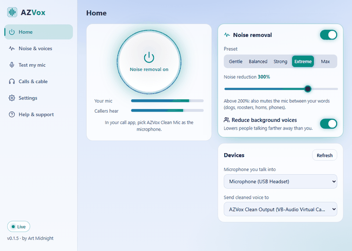

---

## Download

👉 **[Download AZVox for Windows](https://github.com/artmidnight/AZVox-releases/releases/latest)**

On that page, scroll to **Assets** and click **`AZVox_x.y.z_x64-setup.exe`** (the numbers are the version).

You need **Windows 10 or 11**, a microphone or headset, and an internet connection only for downloading.

---

## Quick start (5 minutes)

### 1. Install AZVox

1. Open the file you downloaded (`AZVox_..._setup.exe`).
2. If a blue box says **"Windows protected your PC"**, click **More info**, then **Run anyway**. (Windows shows this for new apps that aren't widely known yet. AZVox is safe.)
3. Read the license, click **I Agree**, then **Install**.
4. If Windows asks *"Do you want to allow this app to make changes?"* during setup, you can click **No**. AZVox works fine without it.
5. AZVox opens by itself when it's done.

### 2. Set up the virtual microphone (one time)

Your call app needs a way to receive AZVox's cleaned-up voice. AZVox does this with a free **virtual microphone**: an extra "microphone" in Windows that carries your clean voice instead of the noisy one. Do this first: it only takes a minute, and everything else builds on it.

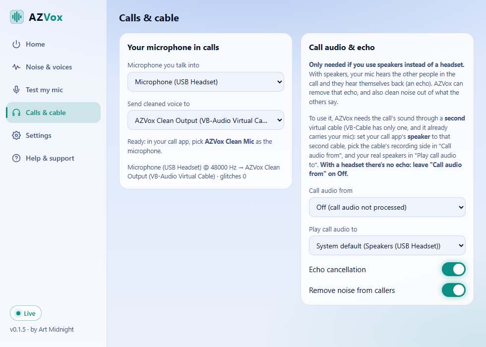

1. In AZVox, click **Calls & cable** in the menu on the left.
2. Click **Get free virtual cable**. AZVox downloads the free VB-Audio Virtual Cable from VB-Audio's website.
3. Click **Yes** when Windows asks for permission.
4. A VB-Audio window opens: click **Install Driver**, then **OK**.
5. AZVox renames it so you can find it easily: **AZVox Clean Mic**.

> If AZVox asks you to restart your PC, do it, then open AZVox and click **Rename to AZVox Clean Mic**.

### 3. Choose your microphone

Still in **Calls & cable** (or on **Home → Devices**):

1. **Microphone you talk into**: pick your real microphone or headset (for example *Microphone (USB Headset)*).
2. **Send cleaned voice to**: make sure it says **AZVox Clean Output**. AZVox picks it for you after step 2; if not, choose it from the list.

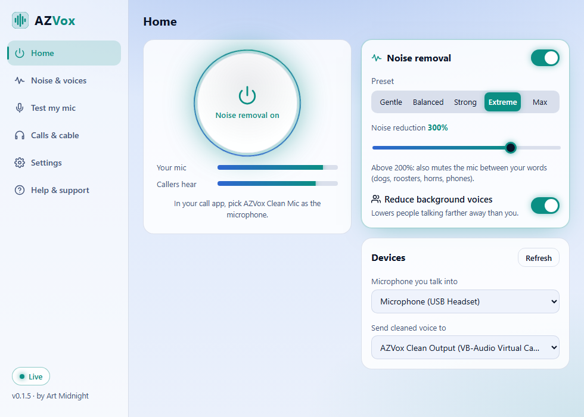

### 4. Hear it for yourself

Go to **Test my mic** in the menu on the left. It records from the microphone you just chose, through AZVox's noise removal.

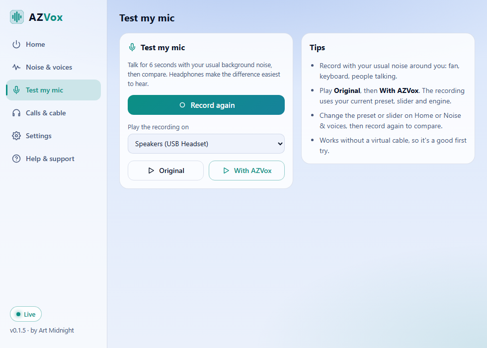

1. **Play the recording on**: choose your headset or speakers (headphones make the difference easiest to hear).
2. Click **Record 6-second test** and talk normally, with your usual noise around you (fan on, TV on, whatever is normal for you).
3. Click **Original** to hear yourself without AZVox.
4. Click **With AZVox** to hear the difference.

Not happy with the result? Try a stronger preset (see *Choosing how strong the noise removal is* below) and record again.

### 5. Turn AZVox on

Go to **Home** and click the big round **power button**. When it glows and says **Live**, AZVox is cleaning your voice.

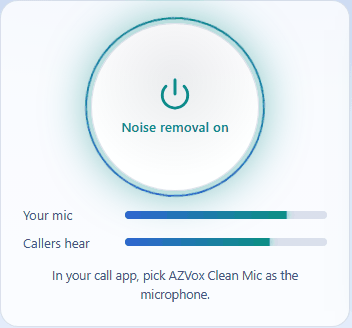

- **Your mic** shows what your microphone hears.
- **Callers hear** shows what the other person will hear. When you stop talking, it should drop to almost nothing: that's the noise being removed.

### 6. Pick AZVox in your call app

In your call app's audio settings, choose **AZVox Clean Mic** as the **microphone**. Leave the speaker/headphones setting as it is.

| App | Where to find it |
|---|---|
| **Zoom** | Settings → Audio → Microphone → **AZVox Clean Mic**. Also set "Suppress background noise" to **Low**. |
| **Discord** | User Settings → Voice & Video → Input Device → **AZVox Clean Mic**. Turn off Discord's own noise suppression. |
| **Microsoft Teams** | Settings → Devices → Microphone → **AZVox Clean Mic** |
| **Google Meet** | ⋮ (three dots) → Settings → Audio → Microphone → **AZVox Clean Mic** |
| **Messenger / WhatsApp / other** | Look for "Microphone" or "Input" in the settings, pick **AZVox Clean Mic** |

That's it. Talk as usual.

---

## Choosing how strong the noise removal is

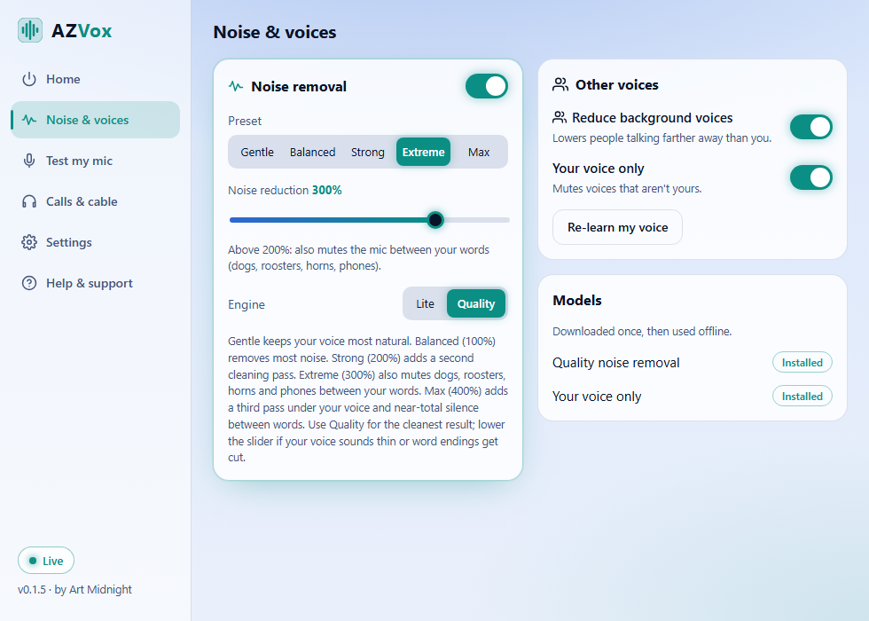

Pick a **preset**, or drag the **Noise reduction** slider:

| Preset | Best for |
|---|---|
| **Gentle** | Quiet rooms. Your voice stays most natural. |
| **Balanced** (default) | Normal homes and offices. Removes most noise. |
| **Strong** | Fans, aircon, traffic outside. |
| **Extreme** | Dogs, roosters, horns, phones, people walking by: also silences your mic between your words. |
| **Max** | Very noisy places. The strongest setting, and it also turns on *Reduce background voices*. |

**Engine:**
- **Lite** uses almost no computer power. Good for older or slower PCs.
- **Quality** is cleaner. It downloads once (about 36 MB) and then works offline. If your PC is too slow for it, AZVox tells you and suggests Lite.

**Other voices:**
- **Reduce background voices** lowers people talking farther away than you.
- **Your voice only**: click **Learn my voice**, talk for about 10 seconds, then switch it on. AZVox then mutes voices that aren't yours, like a TV, a phone on speaker, or family members.

**Tip:** if your voice sounds thin or robotic, or the ends of words get cut, choose a weaker preset or lower the slider a little. **Ctrl+Alt+N** turns noise removal on or off from any app, so you can compare during a call.

---

## Updates

AZVox checks for new versions by itself, when it starts and every few hours. When there's one, you'll see this:

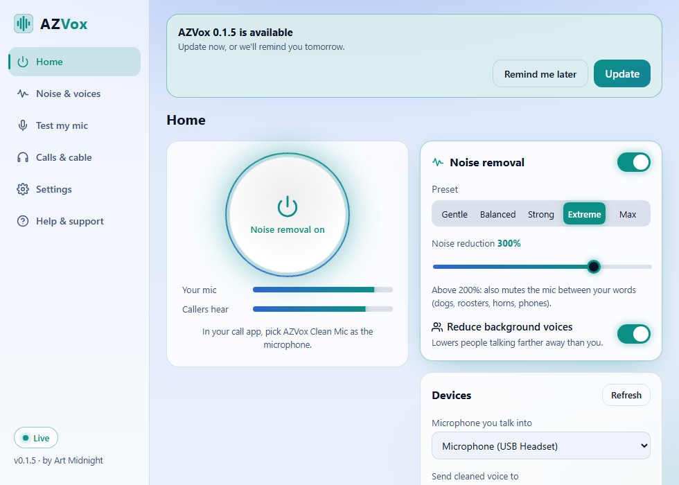

Click **Update**. AZVox downloads the new version, installs it and restarts by itself. **Remind me later** asks again tomorrow. You can also go to **Settings → Check for updates** at any time.

---

## Light or dark

AZVox starts in **light mode**. Prefer dark? **Settings → Appearance → Theme**: **Light**, **Dark**, or **System** (follows Windows).

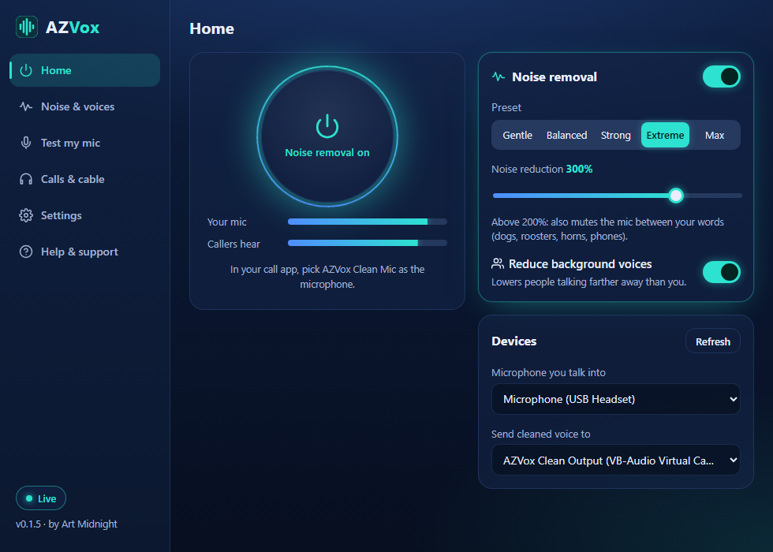

The glowing animations play on every PC, even if Windows animations are turned off. You can turn them off under **Settings → Animations**.

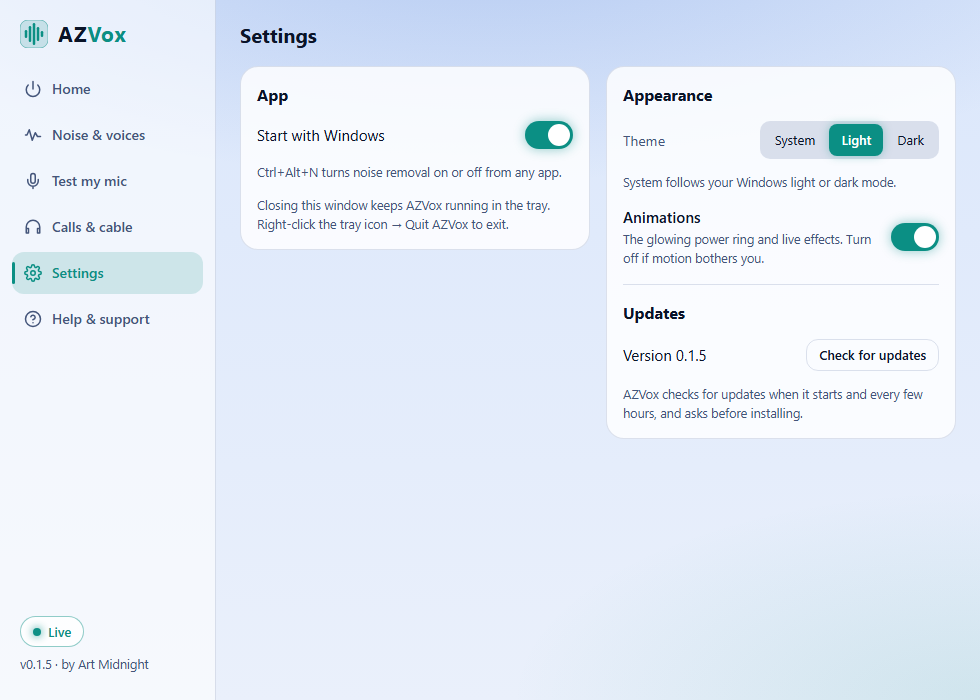

---

## Good to know

- **Closing the window doesn't turn AZVox off.** It keeps running in the system tray (the small icons next to the clock, bottom right). To quit completely: right-click the AZVox icon → **Quit AZVox**.
- **Start with Windows** (Settings) starts AZVox automatically when you turn on your PC.
- **Using speakers instead of a headset?** The other person may hear an echo. See **Calls & cable → Call audio & echo** in the app. With a headset you don't need this.
- **Help & support** in the app has a full step-by-step guide.

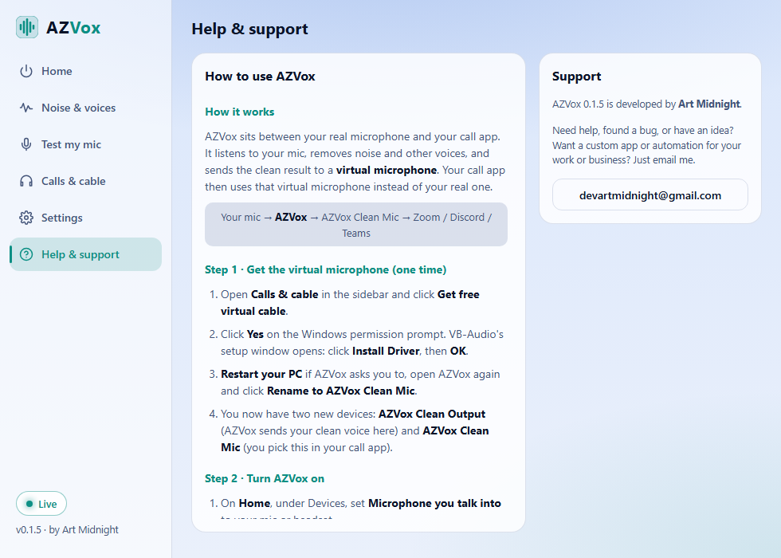

---

## Something not working?

- **The other person can't hear me:** make sure AZVox shows **Live** (power button on), and that your call app's microphone is **AZVox Clean Mic**, not your real microphone.
- **"Your mic" doesn't move when I talk:** on **Home → Devices**, choose the microphone you actually talk into. Also check Windows Settings → Privacy & security → Microphone → *Let desktop apps access your microphone* is on.
- **"No microphone found":** plug in your microphone or headset. AZVox finds it automatically.
- **My voice sounds robotic or words get cut:** choose **Balanced** or **Strong** instead of Extreme or Max.
- **I hear crackling:** choose the **Lite** engine. Your PC may be too busy for Quality.

---

## Privacy

All sound processing happens on your PC. AZVox **never uploads your voice** and collects **no data about you**. It goes online only to check for AZVox updates, and when you ask it to download the optional Quality engine, the voice model or the free virtual cable.

## Support and custom work

Need help, found a bug, or have an idea? Want a **custom app or automation** for your work or business?

📧 **devartmidnight@gmail.com**

### Support AZVox

AZVox is free. If it helps you, you can support its development:

☕ **[Buy me a coffee](https://buymeacoffee.com/artmidnight)**

In the app, **Help & support → Support AZVox** also shows QR codes for **Buy Me a Coffee, GCash, GoTyme Bank (InstaPay), PayPal and Binance (USDT, TRON/TRC20 network)**.

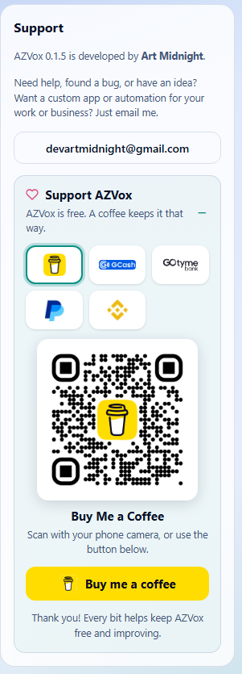

---

AZVox is free to use but not open source. Copyright © 2026 Art Midnight. All rights reserved. This page hosts only the installers and update information. VB-Audio Virtual Cable is donationware by VB-Audio Software and is not part of AZVox.
